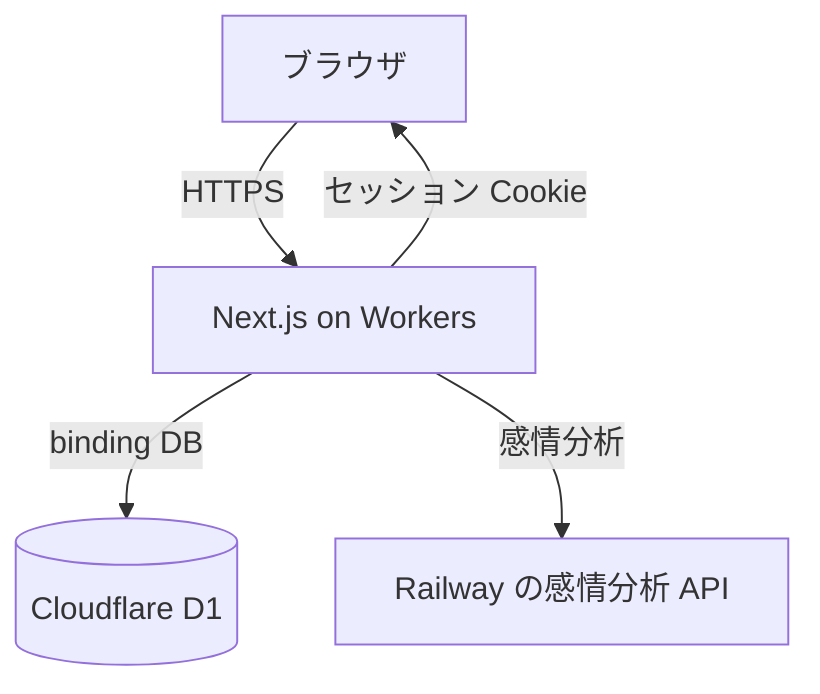
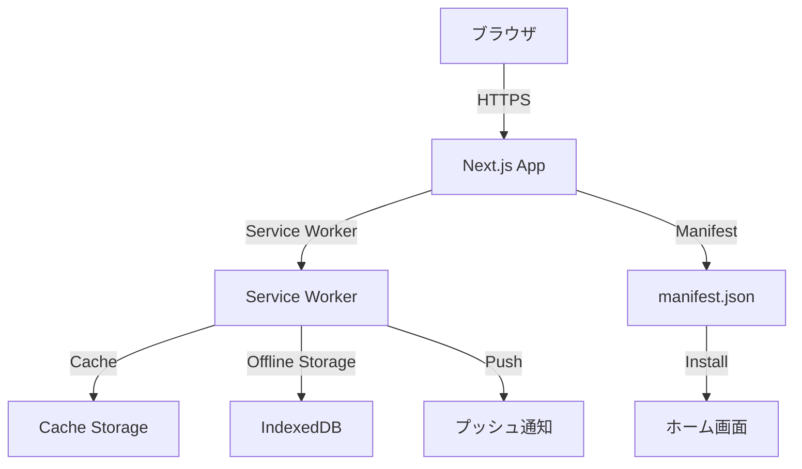
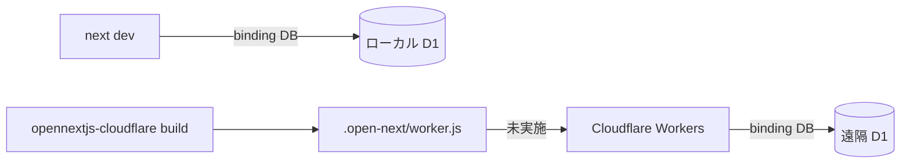

# 詳細設計書：全体アーキテクチャ

## 2. 全体アーキテクチャ

### 2.1 Next.js 16 App Router 構成

```
src/app/
├── layout.tsx          # ルートレイアウト
├── page.tsx            # トップページ
├── dashboard/          # ダッシュボードページ（実装済み）
│   ├── page.tsx        # ダッシュボードメイン
│   └── charts.tsx      # 統合グラフコンポーネント
├── diary/              # 日記関連ページ
│   ├── page.tsx        # 日記一覧
│   ├── [id]/           # 日記詳細・編集
│   └── new/            # 新規作成
└── actions/            # 日記、認証などの Server Actions
```

### 2.2 Workers と D1



画面と Server Actions は Next.js 16 のままです。Workers への搭載は OpenNext（`@opennextjs/cloudflare`）です。AWS 向けの `open-next` パッケージは使いません。

**データの置き場所：**

- **D1（SQLite）**：ユーザー、セッション、日記、入出金、服薬、デフォルト設定
- **binding `DB`**：Workers と `next dev` からこの名前で開く。開発時に binding が取れないときだけ、`.wrangler` 配下の SQLite ファイルを直接開く
- **所有者チェック**：D1 に RLS はない。読み書きはセッションの `user_id` を条件にする。クライアントから渡された `user_id` は信用しない
- **認証**：メールとパスワード。Supabase Auth は使わない

遠隔の D1 は未作成です。`wrangler.jsonc` の `database_id` はプレースホルダです。本番データの移行は、指示があるまで行いません。

### 2.3 Frontend Architecture

```
src/
├── app/                # Next.js App Router ページ
├── components/
│   └── ui/            # shadcn/ui コンポーネント（50+ コンポーネント）
├── schemas/           # Zod スキーマ（テーブル・フォーム用）
│   ├── base.ts        # 共通スキーマ
│   ├── tables/        # テーブルスキーマ（DB行用）
│   ├── forms/         # フォームスキーマ（入力・更新用）
│   └── index.ts       # エクスポート集約
├── lib/
│   ├── db.ts          # D1 の binding。無ければローカル SQLite
│   ├── auth/          # パスワード、セッション、アカウント
│   ├── utils.ts       # ユーティリティ関数
│   └── ai/            # 感情分析 API とモック
├── hooks/
│   └── use-mobile.ts  # モバイル判定フック
└── proxy.ts           # ルート保護。middleware.ts は作らない
```

### 2.4 感情分析

感情分析 API は Railway に置いたままです。この移行の対象外です。日記の保存時に Server Action から呼び、失敗しても日記の保存は続けます。文章補完とトピック抽出の本実装は、まだモックです。

```
日記保存 → Server Action → Railway の感情分析 API → 結果を D1 に保存
```

### 2.5 PWA構成（将来実装）



**主要機能:**

- **Service Worker**: オフライン対応、キャッシング、プッシュ通知
- **manifest.json**: PWA メタデータ、インストール設定
- **IndexedDB**: オフライン時のデータストレージ
- **Cache Storage**: 静的アセット・API レスポンスのキャッシュ

**ファイル構成:**

```
public/
├── manifest.json          # PWA マニフェスト
├── sw.js                  # Service Worker
├── icon-192x192.png      # アプリアイコン（192x192）
├── icon-512x512.png      # アプリアイコン（512x512）
└── icon-maskable.png     # マスク可能アイコン

src/
├── components/
│   └── pwa/
│       ├── InstallPrompt.tsx      # インストールプロンプト
│       ├── OfflineIndicator.tsx   # オフラインインジケーター
│       └── PwaScript.tsx          # Service Worker 登録
└── lib/
    └── offline-storage.ts         # IndexedDB 操作
```

### 2.6 デプロイ構成（Cloudflare Workers）

**実装状況:** ローカルの D1 と OpenNext の設定まで。遠隔の Worker と D1 は未作成。



**現状：**

- ローカル開発は `next dev`。OpenNext が wrangler のローカル D1 を binding にする
- 本番用のビルドコマンドは `pnpm preview` と `pnpm deploy`。中身は `opennextjs-cloudflare build` のあと preview または deploy
- Windows では、シンボリックリンクの作成権限と `sharp` の同梱で Workers 向けバンドルが止まる。`next build` 自体は通る
- 手順: [801_Deploy_Workers.md](../800_Release/801_Deploy_Workers.md)

データ更新用の Route Handler は増やさない。更新は Server Actions です。

---

**関連ドキュメント:**

- [基本設計書](./100_BasicDesign.md)
- [機能設計](./204_DetailedDesign_Functions.md)
